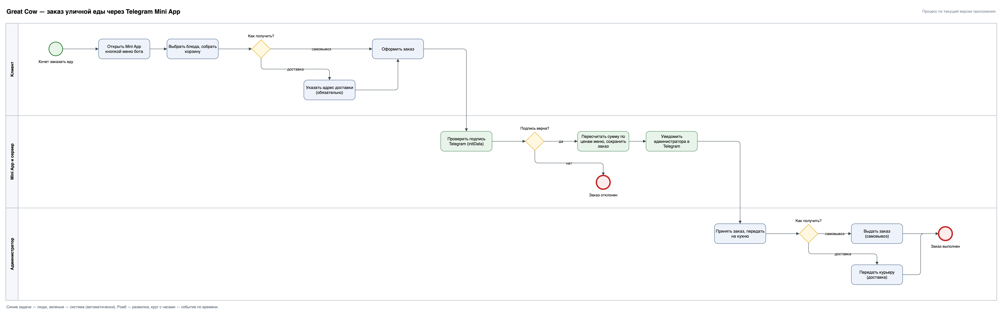

# Great Cow: заказ уличной еды в Telegram

Кейс бизнес- и системного аналитика: заказ в заведении уличной еды через Telegram. В 2022 году у моего заведения в Саратове был бот для заказа, который программист сделал по моим требованиям. В 2026 году процесс и требования описаны заново, уже для Telegram Mini App: меню на 33 позиции, корзина, самовывоз или доставка, уведомление администратору.

**Статус:** сервис сейчас не запущен, живой ссылки на бота нет. В репозитории остались требования, схема процесса, модель данных, описание API и код приложения.

## Моя роль

- Идея и постановка задачи: заказать еду, не звоня в заведение.
- Требования к заказу, оплате и уведомлениям; правила, которые защищают деньги и данные: сумма заказа считается на сервере, заказ принимается только с проверенной подписью Telegram.
- Процесс заказа в BPMN, модель данных и описание API.
- Сценарии проверки и приемка результата.

Я аналитик, а не разработчик: код в репозитории реализует эти требования.

## Процесс заказа

## Подробности

Требования, данные, API и принятые решения: [greatcow-bot/README.md](greatcow-bot/README.md).

## Стек

Node.js · Express · node-telegram-bot-api · SQLite · Vanilla JS · Telegram WebApp SDK

---

Виктор Чернышев — бизнес- и системный аналитик · Telegram [@cherny_shevv](https://t.me/cherny_shevv)
