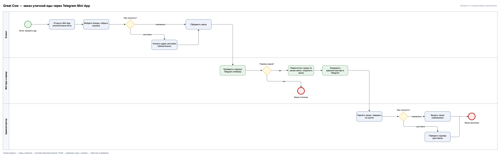

# Great Cow — заказ уличной еды в Telegram

## История

В 2022–2023 годах у меня было заведение уличной еды в Саратове. Одним из каналов продаж был Telegram-бот для заказа: я сформулировал требования к заказу и оплате, вел работу с программистом, тестировал сценарии и принимал результат.

В 2026 году бот спроектирован заново как Telegram Mini App: тот же фирменный стиль, новое меню, полноценное приложение вместо переписки с ботом.

**Статус:** сервис сейчас не запущен, живой ссылки на бота нет. В репозитории остались требования, схема процесса, модель данных, API и код приложения.

## Моя роль

- Идея и постановка задачи: заказать еду, не звоня в заведение.
- Требования к заказу, оплате и уведомлениям; правила, которые защищают деньги и данные (см. «Решения»).
- Процесс заказа в BPMN, модель данных и описание API.
- Сценарии проверки и приемка результата.

Я аналитик, а не разработчик: код в репозитории реализует эти требования.

## Что умеет

- Меню на 33 позиции по категориям: хот-доги, бургеры, шаурма, закуски, салаты, десерты, напитки.
- Корзина и оформление: самовывоз или доставка (для доставки адрес обязателен).
- Уведомление администратору о новом заказе прямо в Telegram.
- `/start`, `/support`, `/feedback`, для администратора — `/feedbacklist`.

## Процесс заказа



## Данные и API

| Таблица | Что хранит |
|---|---|
| `orders` | заказ: пользователь Telegram, состав, сумма, способ получения, адрес |
| `feedback` | отзывы пользователей |

| Метод | Назначение |
|---|---|
| `GET /api/menu` | меню |
| `POST /api/order` | оформить заказ: проверка подписи Telegram, пересчет суммы по ценам меню |

## Решения

- Сумма заказа считается на сервере; цена, пришедшая из корзины, не используется.
- Заказ принимается только с проверенной подписью Telegram (`initData`).
- Меню вынесено в `menu-data.js` — владелец меняет позиции без правки логики.
- Описание бота и кнопка меню выставляются через Bot API скриптом `npm run setup-profile`, без ручной настройки в BotFather.

## Структура

```
server.js            — Express-сервер, API меню и заказа
bot.js               — команды бота и уведомления
db.js                — SQLite: orders, feedback
menu-data.js         — меню
setup-bot-profile.js — описание и кнопка меню через Bot API
public/              — Mini App: index.html, app.js, styles.css, логотип и баннер
```
